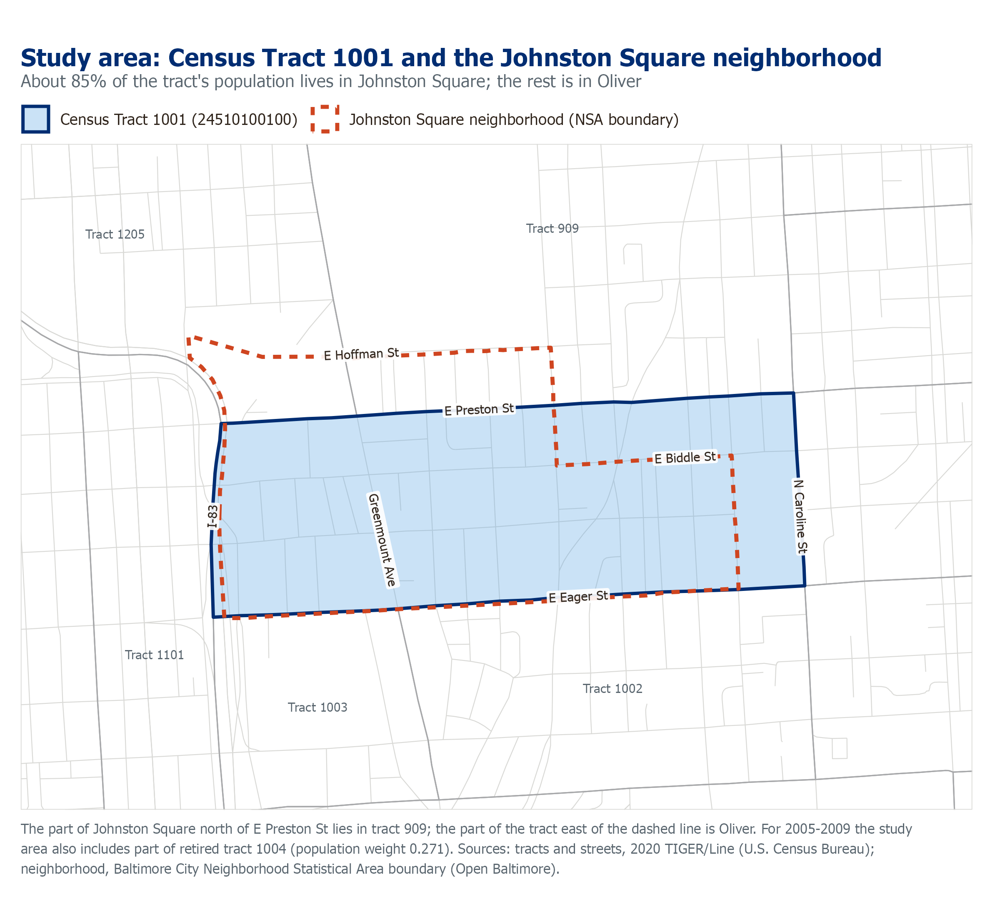

# Johnston Square Analysis

How the Johnston Square neighborhood of East Baltimore has changed across four
American Community Survey (ACS) periods, 2005-2009 to 2020-2024: population,
race and ethnicity, income, poverty, education, employment, housing tenure,
housing costs and vacancy. Baltimore City is shown alongside for comparison.

Prepared for the Johns Hopkins University Public Impact Initiatives. The
method follows JHU's earlier East Baltimore Development Initiative (EBDI)
analysis.



---

## At a glance

| | 2005-09 | 2010-14 | 2015-19 | 2020-24 |
|---|---|---|---|---|
| Population, study area | 2,263 | 2,095 | 2,259 | 1,404 |
| Vacancy rate, study area (± MOE) | 27.8% (±9.7) | 30.0% (±6.2) | 26.1% (±7.9) | 20.2% (±10.6) |
| Vacancy rate, Baltimore City | 19.3% | 18.8% | 19.1% | 13.5% |
| Avg. household income, Black households, study area | $41,003 | $28,550 | $34,655 | $37,677 |
| Avg. household income, all households, Baltimore City | $54,017 | $58,813 | $72,137 | $86,503 |

The study area is small (about 1,400 people today), so **margins of error are
wide**: about ±20-24% on total population in the two most recent periods.
Show or footnote MOEs whenever you compare periods. Incomes are averages (not
medians) and are not adjusted for inflation between periods. See
[Using the numbers](#using-the-numbers).

All figures are in [`output/figures/`](output/figures/), and all data is in
[`output/`](output/).

---

## Quick start

You need **R 4.1 or later** ([download](https://cran.r-project.org/)).
RStudio is optional.

**1. Install the R packages** (one time):

```r
install.packages(c("tidycensus", "tidyverse", "R.utils", "sf", "tigris", "ragg"))
```

**2. Get a Census API key** (free, one time). Request one at
<https://api.census.gov/data/key_signup.html>, then in R:

```r
tidycensus::census_api_key("YOUR_KEY_HERE", install = TRUE)
```

Restart R afterwards. The key is saved to your `~/.Renviron`, outside this
repository.

**3. Check your setup.** From the repository folder, run:

```bash
Rscript R/check_env.R
```

Every line should read `PASS`.

**4. Run the analysis:**

```bash
Rscript js_analysis_2026.R
```

A run takes about **2 minutes**. The first run also downloads about 550 MB of
Census replicate-weight files into `data/` (once only), so allow extra time.
The run rewrites every CSV and figure in `output/`.

*In RStudio:* open `Johnston Square Analysis.Rproj`, then open
`js_analysis_2026.R` and click **Source**.

---

## What you get

| Output | What's in it |
|---|---|
| `output/figures/*.png` | Eight slide-ready figures, plus the study-area map |
| `output/js_*_summary.csv`, `js_vacants.csv` | Study-area population by race, Hispanic origin, vacancy and income, by period |
| `output/city_*.csv` | The same summaries for Baltimore City |
| `output/js_*_results.csv`, `js_educ_summary.csv` | Ten detailed tables (age, tenure, poverty, education, crowding, employment, income, rent, mortgage and vacancy), with every share and its margin of error, by race where the ACS publishes it |

**[docs/outputs.md](docs/outputs.md)** describes every file and column. Note
that the detailed tables use percentages (0-100) and the summaries use
fractions (0-1).

---

## Using the numbers

1. **The study area is Census Tract 1001**, which is about 85% Johnston
   Square and 15% the neighboring Oliver. The ACS does not publish data for
   neighborhoods, and this tract is the closest available match. Call it "the
   Johnston Square study area" or "Census Tract 1001" when precision matters.
2. **2005-2009 includes part of a second tract.** Census redrew tract 1001 in
   2010, so the 2005-09 figures add 27.1% of retired tract 1004 to match
   today's boundary. Without this adjustment, the population drop would look
   like 51% instead of 38%. Footnote it wherever 2005-09 appears.
3. **Margins of error are wide.** Small changes between periods may be noise.
   No significance tests are reported.
4. **Citywide vacancy and income leave out about 4% of housing units** after
   2009, because of renumbered tracts. This is inherited from the EBDI method.
   See known limitations.

The full method, the reasoning behind the study area, and every known
limitation are in **[docs/methodology.md](docs/methodology.md)**.

---

## Repository layout

```
js_analysis_2026.R        the analysis: run this
R/                        modules it uses, plus setup, geography and map scripts
tests/                    unit checks and the frozen baseline (tests/golden/)
geo/                      Johnston Square boundary and tract apportionment
output/                   results: CSVs and figures/
docs/                     methodology, outputs guide, maintenance guide
data/                     replicate-weight downloads (created on first run; not in git)
```

## Documentation

| Read this | To |
|---|---|
| [docs/outputs.md](docs/outputs.md) | Understand a file or column |
| [docs/methodology.md](docs/methodology.md) | Understand how the study area and numbers were derived, and their limits |
| [docs/maintenance.md](docs/maintenance.md) | Change the code, add an ACS period, check results, or reuse this for another neighborhood |

---

## Credits

The analytical method and the original EBDI code are by **Marlene Caceres**
(2021). The EBDI code was consolidated in 2026. **Good Enough** (Justin
Elszasz) adapted it for Johnston Square in 2026.

Data: U.S. Census Bureau, American Community Survey 5-year estimates and
Variance Replicate Tables. Neighborhood boundary: Baltimore City, Open
Baltimore.
